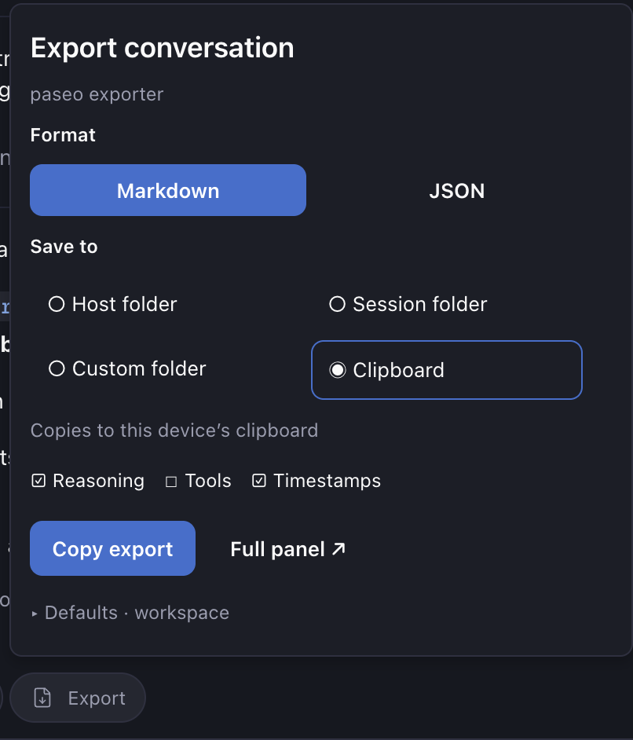
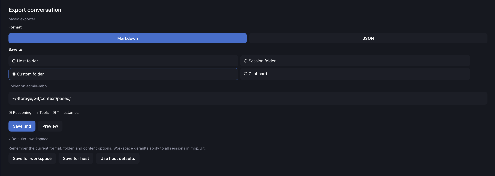

# Paseo exporter

Export a session as formatted Markdown or structured JSON using a composer **Export** button, `/export`, or the Command Center.

## Use

1. Open a session and click **Export** above its composer.
2. Choose **Markdown** or **JSON**.
3. Select **Host exports folder**, **Session folder**, **Custom host folder**, or **Clipboard**.
4. Choose whether to include reasoning, tool calls/results, and timestamps.
5. Click **Save .md / .json** or **Copy export**. Choose **Full panel** for a formatted preview.

The bubble uses compact format and destination buttons, with one description for the selected location. Paseo owns its scrolling; there is no nested scroll view. Session updates preserve the Export button and open controls.

The Command Center action **Export conversation as Markdown or JSON** and `/export` open the same controls in a larger session panel. The current Paseo plugin API does not expose the session tab’s right-click menu or custom keyboard shortcuts. Use Cmd+K / Ctrl+K to reach the command.

Host exports go to `~/Paseo Exports`. Session exports go to `<session working directory>/Paseo Exports`. Custom folders accept absolute paths or `~/...`. Folders are created as needed, and files use a sanitized title, agent ID, timestamp, and random suffix. Existing files are never overwritten. Files are created with mode `0600`; newly created folders use `0700`, subject to platform filesystem support. Remote host destinations refer to the remote machine. Clipboard exports refer to the device running the app.

## Screenshots

Export controls beside the session composer:



Full export panel with workspace defaults:



## Saved defaults

Open **Export**, select your format, destination, and content options, then expand **Defaults**:

- **Save for workspace** remembers those settings for every session in the current workspace.
- **Save for host** sets the fallback for workspaces on the connected host.
- **Use host defaults** removes the current workspace override.

Saved values apply when you reopen Export. Changing controls for one export does not change defaults unless you explicitly save them. Workspace overrides take precedence over host defaults. Tool calls remain selectable even when excluded by default.

Preferences are stored through Paseo’s host-side plugin settings, shared by clients connected to that host, and survive plugin reloads, updates, and daemon restarts. Removing the plugin deletes its settings. Personal paths and choices are not stored in this repository. Custom folders are created only when you save an export.

## Install locally

Requires Paseo **0.13.0-beta.1 or a compatible later release**, including the app that renders client contributions. Enable plugins in Paseo settings, then:

```sh
paseo plugin install github:sgoley/paseo-exporter
```

Paseo compiles the TypeScript sources and supplies runtime libraries. There is no runtime dependency installation or build command.

## Export contents

Markdown preserves message Markdown and includes session metadata, numbered user/assistant messages, reasoning, tool details and errors, task checkboxes, notices, compaction markers, and plugin rows. Reasoning and tool details use standard Markdown inside HTML `details` blocks, supported by GitHub and many Markdown viewers. Viewers without HTML disclosure support may display these differently.

JSON has `schemaVersion: 1`, `exportedAt`, `options`, `session`, and `entries`. Each entry contains the original structured timeline item, provider, sequence ranges, collapse metadata, and optional timestamp. It is intended for downstream processing, not re-import into Paseo. Session metadata includes provider, model, and reasoning effort at export time. Effective/runtime values take precedence over configuration; configured provider, model, and effort are preserved separately. Unreported effort is `null` in JSON and “Not reported” in Markdown. These settings are exported even when reasoning text is excluded. Historical model/effort changes are not exposed per message by Paseo. Only relevant metadata is exported, rather than the full agent configuration.

The exporter walks all available history pages backwards from the initial newest boundary and restores chronological order. It requests Paseo’s projected history to avoid repeated streaming deltas and tool lifecycle updates. Cursor failures, history replacement, and reported gaps fail the export instead of silently saving a partial file.

A snapshot can include an active/unfinished turn. Exports cannot recover material removed by provider retention or compaction. Attachments are represented only as exposed by Paseo’s timeline; binary files are not embedded or copied. Child-agent histories remain separate sessions. Message timestamps are the timeline timestamps supplied by Paseo; they are not reconstructed.

The plugin makes no external network requests. Preview and clipboard content travels over the existing Paseo connection. Saved files can include sensitive conversation and tool output, including secrets that were already in the session.

## Development

```sh
npm ci
npm run check
paseo plugin reload paseo-exporter
paseo plugin logs paseo-exporter
npm pack --dry-run --ignore-scripts
```

Source layout:

- `index.client.tsx`: composer button, command, slash command, and panel registration.
- `client/export-panel.tsx`: shared popover/panel controls and themed preview.
- `index.server.ts`: RPC registration.
- `server/history.ts`: complete history pagination and consistency checks.
- `server/markdown.ts`: Markdown formatting and filename generation.
- `server/export.ts`: JSON formatting, destination selection, and exclusive file writes.
- `shared/export.ts`: validated RPC contracts.
- `tests/export.test.ts`: pagination, format, filtering, error, destination, and save tests.

GitHub Actions runs typechecking, all tests, and a package contents check on every push and pull request, using Node.js 22 and 24. The workflow can also be started manually.

The public GitHub repository is the distribution source. The package is marked `private` to prevent accidental npm publication; this does not affect Git installation in Paseo. `OVERVIEW.md` is included for the plugin listing.
